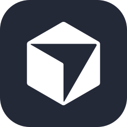
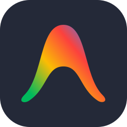
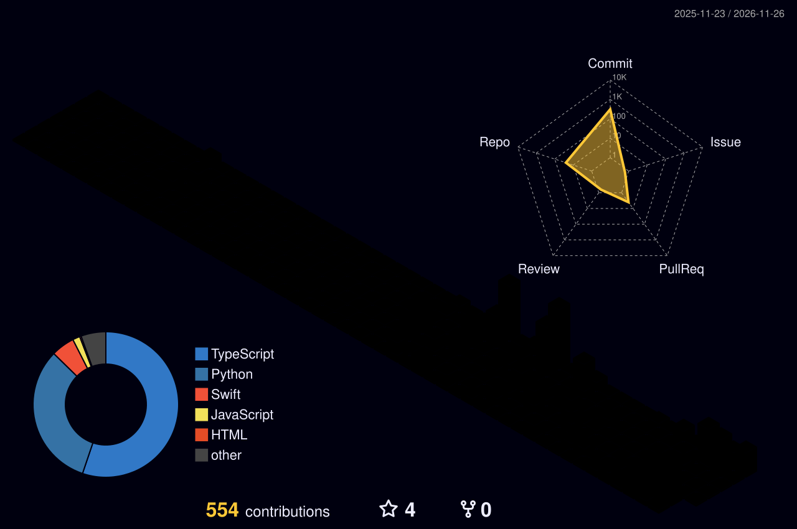

  

## 💫 About Me

  

---

  <strong>AI/ML Engineer · Full-Stack Builder · Aspiring Founder</strong>

  Computer Science (AI/ML) student building verifiable agent memory layers, sandboxed security tooling, deterministic-plus-LLM pipelines, and full-stack AI products. Focused on turning agentic systems, MCP infrastructure, automation, and trading &amp; product ideas into reliable software.

  
  &nbsp;
  
  &nbsp;
  

## 🏆 GitHub Trophies

  

## 🛠️ Technology Stack

| Domain | Technologies |
| :--- | :--- |
| **Languages** |  |
| **Frontend** |  |
| **Backend &amp; Data** |  |
| **AI/ML &amp; Agent Stack** |  &nbsp;    |
| **Embedded &amp; IoT** |   &nbsp;  |
| **Developer Tools** |    |

## 📊 GitHub Stats

  
  &nbsp;
  

  

## 👾 3D Contribution Graph

  <picture>
    <source media="(prefers-color-scheme: dark)" srcset="https://raw.githubusercontent.com/Vrajesh-sulakhe/Vrajesh-sulakhe/output/3d-contrib/profile-night-rainbow.svg" />
    <source media="(prefers-color-scheme: light)" srcset="https://raw.githubusercontent.com/Vrajesh-sulakhe/Vrajesh-sulakhe/output/3d-contrib/profile-green-animate.svg" />
    
  </picture>

## 📈 Contribution Graph

  

## 🐍 Contribution Snake

  <picture>
    <source media="(prefers-color-scheme: dark)" srcset="https://raw.githubusercontent.com/Vrajesh-sulakhe/Vrajesh-sulakhe/output/github-snake-dark.svg" />
    <source media="(prefers-color-scheme: light)" srcset="https://raw.githubusercontent.com/Vrajesh-sulakhe/Vrajesh-sulakhe/output/github-snake.svg" />
    
  </picture>

## 🚀 Featured Projects

<table>
  <tr>
    <td width="50%" valign="top">
      <h3>🧠 <a href="https://github.com/Vrajesh-sulakhe/Lethe">Lethe</a></h3>
      
<strong>Verifiable Memory OS for AI Agents (MCP)</strong>

      
Local-first persistent memory operating system exposed via Model Context Protocol. Implements bitemporal valid-time tracking, source-trust taint quarantine, lineage-DAG cascading deletion, epistemic abstention gating, and greedy knapsack token-budget packing on SQLite WAL.

      
<code>Python</code> · <code>MCP</code> · <code>SQLite WAL</code> · <code>Pydantic</code> · <code>Tiktoken</code> · <code>NumPy</code>

      

        
      

    </td>
    <td width="50%" valign="top">
      <h3>🛡️ <a href="https://github.com/Vrajesh-sulakhe/PhishnChips">PhishnChips</a></h3>
      
<strong>Sandboxed Phishing Detonation &amp; Threat Intel Agent</strong>

      
Host/Agent/Caged-Sandbox detonation engine built for Vultr Agent Rush (Track 01: Blast Radius Zero). Pairs kernel-enforced <code>iptables</code> isolation and ephemeral Playwright Chromium containers with static JS/WASM disassembly, SSE telemetry, and LLM threat verdicts.

      
<code>Python</code> · <code>FastAPI</code> · <code>React</code> · <code>TypeScript</code> · <code>Three.js</code> · <code>Playwright</code> · <code>Docker</code>

      

        
        
      

    </td>
  </tr>
  <tr>
    <td width="50%" valign="top">
      <h3>⚗️ <a href="https://github.com/Vrajesh-sulakhe/Crucible">Crucible</a></h3>
      
<strong>Deterministic Industrial Product Intelligence</strong>

      
Six-stage catalog intelligence pipeline built on the principle <em>"The AI Reads. The Code Decides."</em> Confines Gemini extraction to unstructured parsing while deterministic Python handles Pint unit normalization, physical-law validation, confidence scoring, and human-in-the-loop conflict resolution.

      
<code>Next.js</code> · <code>TypeScript</code> · <code>Python</code> · <code>FastAPI</code> · <code>Pint</code> · <code>Docker</code>

      

        
        
      

    </td>
    <td width="50%" valign="top">
      <h3>🩺 <a href="https://github.com/Vrajesh-sulakhe/Tavya">Tavya</a></h3>
      
<strong>Accessible Care Circle &amp; Medication Platform</strong>

      
Passcode-secured elderly care platform featuring salted <code>scryptSync</code> authentication, stateless HMAC-SHA256 RBAC, senior-controlled privacy consent toggles, multilingual (EN/HI/MR) voice read-aloud, Gemini prescription parsing, and proactive Resend email reminders.

      
<code>Next.js</code> · <code>React</code> · <code>TypeScript</code> · <code>Tailwind CSS</code> · <code>Upstash Redis</code> · <code>Vitest</code>

      

        
        
      

    </td>
  </tr>
  <tr>
    <td width="50%" valign="top">
      <h3>🎙️ <a href="https://github.com/Vrajesh-sulakhe/F.R.I.D.A.Y">F.R.I.D.A.Y</a></h3>
      
<strong>Voice-Controlled Personal AI Assistant Server</strong>

      
Local-first voice assistant backend running FastAPI and WebSockets with multi-provider LLM routing (Anthropic &amp; OpenAI-compatible), <code>faster-whisper</code> / ONNX voice pipeline, second-brain indexing, token tracking, and system tool integrations.

      
<code>Python</code> · <code>FastAPI</code> · <code>WebSockets</code> · <code>Anthropic SDK</code> · <code>faster-whisper</code> · <code>JavaScript</code>

      

        
      

    </td>
    <td width="50%" valign="top">
      <h3>⚖️ <a href="https://github.com/Vrajesh-sulakhe/Pramaan">Pramaan</a></h3>
      
<strong>Evidence-First Document Verification Engine</strong>

      
Citizen-first verification platform that extracts fields from bills, leases, and payslips, looks up cited official rulebooks over MCP, computes deterministic arithmetic gaps, and gates outbound actions behind explicit human confirmation.

      
<code>TypeScript</code> · <code>MCP</code> · <code>Tesseract.js</code> · <code>Monorepo</code>

      

        
      

    </td>
  </tr>
</table>

> **Also building:** [**Orchestr**](https://github.com/Vrajesh-sulakhe/Orchestr) *(AI Buildathon command center with Next.js, Prisma &amp; Gemini)* · [**skills-master**](https://github.com/Vrajesh-sulakhe/skills-master) *(Multi-harness AI agent skill routing &amp; autonomous execution protocols)*

## 🔭 Current Focus

- **Agent Memory &amp; MCP Infrastructure:** Building local-first, verifiable memory and context routing systems across AI coding agents (`Lethe`, `skills-master`).
- **Deterministic-Plus-LLM Architectures:** Pairing model extraction with strict domain math, physical-law invariants, and audit logs (`Crucible`, `Pramaan`).
- **Sandboxed Autonomous &amp; Security Systems:** Designing isolated agent execution sandboxes, threat intel pipelines, and developer tooling (`PhishnChips`).
- **Product Engineering:** Shipping full-stack AI applications, automation workflows, and trading system experiments.

## ✍️ Random Dev Quote

  

## 💖 Support Me

  

  <a href="https://ascii.rest/banner/">
    <picture>
      <source media="(prefers-color-scheme: dark)" srcset="https://ascii.rest/banner/ALPHA.dark.svg?color=580000,ff0000&speed=fast&font=mixed&shadow=ascii&fill=light&size=l&bg=240000" />
      
    </picture>
  </a>

